<div align="center">

# zorVPN

### High-Performance Multi-Protocol Subscription Infrastructure & Active Health Filter

[](https://zorvpn.xxaweii.workers.dev/)
[](https://hamzawih0.github.io/zorVPN/)
[](https://github.com/MetaCubeX/mihomo)
[](https://github.com/hamzawih0/zorVPN/actions)
[](LICENSE)

<br/>

**[🌐 Launch Official Web Portal](https://zorvpn.xxaweii.workers.dev/)** • **[🌍 GitHub Pages Mirror](https://hamzawih0.github.io/zorVPN/)** • **[📖 Architecture Deep Dive](clash-yaml-deep-dive.md)**

</div>

---

## 📌 Overview

**zorVPN** is an automated proxy aggregation, latency verification, and multi-format subscription generator designed for resilient global connectivity. 

Upstream public proxy feeds frequently suffer from stale nodes, rate limits, and DNS poisoning. zorVPN solves this by continuously harvesting candidate configurations from **16+ high-frequency global repositories and feeds**, validating every candidate through a local **Mihomo (Clash.Meta) kernel via genuine HTTP 204 latency probes**, discarding dead/blocked entries, and publishing optimized configurations tailored for every operating system.

### Key Capabilities
- **Zero-Lag iOS Profiles**: Dedicated flat Base64 feeds (Lite 30-node and Standard 60-node) preventing Shadowrocket UI freezes.
- **Unified Android Hub**: Dynamic drawer switching between **v2rayNG** and **Clash Meta** with direct CDN APK downloads.
- **Active Mihomo Probing**: Nodes must pass real TCP handshakes and HTTP 204 benchmarks before entering production pools.
- **GFW-Resilient Edge Delivery**: Deployed on Cloudflare Workers, jsDelivr Global CDN, and GHProxy mirrors with automatic failover.
- **Smart Grouping**: Pre-configured rules for AI services (ChatGPT, Claude, Gemini), global streaming (Netflix, YouTube), and direct Chinese bypass.

---

## 🏗️ Architecture Pipeline

```mermaid
flowchart TD
    subgraph Upstreams ["1. High-Frequency Upstream Feeds (16+ Providers)"]
        U1["v2nodes.com (Live API)"]
        U2["MatinGhanbari (15m Refresh)"]
        U3["barry-far (15m Refresh)"]
        U4["Nexus Nodes (4h Sorted)"]
        U5["lyqnihao (12h Meta-Aggregator)"]
        U6["jichangx / v2rayfree (Daily Batches)"]
    end

    subgraph Ingestion ["2. Ingestion & Normalization Engine (scripts/update.py)"]
        I1["YAML / Base64 / URI Decoding"]
        I2["Protocol Parsing (VLESS Reality, VMess, Trojan, Hysteria2, SS)"]
        I3["Spam & Advertising Sanitizer"]
        I4["SHA-256 Node Deduplication"]
    end

    subgraph Probe ["3. Active Health Verification (Mihomo Meta Core)"]
        P1["Mihomo Micro-Daemon Spawned"]
        P2["Parallel Workers (35 concurrent)"]
        P3["HTTP 204 Delay Probe (2500ms timeout)"]
        P4["Latency Sort & Dead Node Elimination"]
    end

    subgraph Emission ["4. Artifact Generation & Classification"]
        E1["ZorVPN.yaml (Full Clash/Mihomo Profile)"]
        E2["ZorVPN-lite.txt (iOS Top 30 Base64)"]
        E3["ZorVPN.txt (iOS Top 60 Base64)"]
        E4["ZorVPN-all.txt (Complete Base64 Archive)"]
        E5["ZorVPN-nodes.txt (Plaintext URI Stream)"]
    end

    subgraph Edge ["5. Global Edge Distribution"]
        D1["Cloudflare Workers (Auto UA Detection & Cache)"]
        D2["jsDelivr Multi-CDN Acceleration"]
        D3["GHProxy Mainland Fast Mirror"]
    end

    Upstreams --> Ingestion
    Ingestion --> Probe
    Probe --> Emission
    Emission --> Edge
```



---

## ⚡ Subscription Endpoints

Because `raw.githubusercontent.com` is blocked by the Great Firewall (GFW) in Mainland China, users without an active proxy should utilize the **Cloudflare Edge**, **jsDelivr**, or **GHProxy** accelerated mirrors below.

### 📱 iOS Clients (Shadowrocket, Loon, Quantumult X)
> **Recommended**: Shadowrocket renders all nodes in a flat list. Standard large YAML files cause memory spikes and UI lag. These curated Base64 endpoints load in **0.05 seconds**.

| Tier | Curated Size | ☁️ Cloudflare Edge (Recommended) | ⚡ jsDelivr Global CDN | 🚀 GHProxy China Mirror |
| :--- | :---: | :--- | :--- | :--- |
| 🚀 **iOS Lite** | **Top 30 Nodes** | `https://zorvpn.xxaweii.workers.dev/lite` | `https://cdn.jsdelivr.net/gh/hamzawih0/zorVPN/ZorVPN-lite.txt` | `https://ghproxy.net/https://raw.githubusercontent.com/hamzawih0/zorVPN/main/ZorVPN-lite.txt` |
| ⚡ **iOS Standard** | **Top 60 Nodes** | `https://zorvpn.xxaweii.workers.dev/ios` | `https://cdn.jsdelivr.net/gh/hamzawih0/zorVPN/ZorVPN.txt` | `https://ghproxy.net/https://raw.githubusercontent.com/hamzawih0/zorVPN/main/ZorVPN.txt` |
| 🌐 **Full Pool** | All Verified | `https://zorvpn.xxaweii.workers.dev/all` | `https://cdn.jsdelivr.net/gh/hamzawih0/zorVPN/ZorVPN-all.txt` | `https://ghproxy.net/https://raw.githubusercontent.com/hamzawih0/zorVPN/main/ZorVPN-all.txt` |

---

### 💻 Clash & Mihomo Clients (Clash Verge Rev, Clash Meta, FlClash, Stash, Sing-box)

| Mirror Provider | Subscription URL | Notes |
| :--- | :--- | :--- |
| ☁️ **Cloudflare Edge** *(Primary)* | `https://zorvpn.xxaweii.workers.dev/clash` | Automatic client routing & edge caching |
| ⚡ **jsDelivr Global CDN** | `https://cdn.jsdelivr.net/gh/hamzawih0/zorVPN/ZorVPN.yaml` | Worldwide edge acceleration |
| 🚀 **GHProxy Mirror** | `https://ghproxy.net/https://raw.githubusercontent.com/hamzawih0/zorVPN/main/ZorVPN.yaml` | Direct China optimization |
| 🌐 **GitHub Raw** *(Requires Proxy)* | `https://raw.githubusercontent.com/hamzawih0/zorVPN/main/ZorVPN.yaml` | Direct source |

---

## 🎯 Smart Routing & Proxy Groups

Each generated Clash profile includes production-grade rules and automated health groups:

| Proxy Group | Strategy | Functional Scope |
| :--- | :--- | :--- |
| 🎯 **zorVPN** | `select` | Master selector: choose between speed strategies, fallback, or specific countries. |
| ⚡ **Fastest** | `url-test` | Automated real-time latency selection (300s interval, 50ms tolerance). |
| 🛡️ **Fallback** | `fallback` | Cascading high-availability failover across geographic clusters. |
| 🤖 **AI Services** | `url-test` | Targeted low-latency routing for OpenAI, Claude, Google Gemini, Perplexity, and Poe. |
| 🎬 **Streaming** | `url-test` | Optimized for Netflix, YouTube, Spotify, Disney+, Twitch, and TikTok. |
| 🇭🇰 🇯🇵 🇸🇬 🇺🇸 🇩🇪 ... | `url-test` | Dedicated country clusters covering **40+ regions** worldwide. |

---

## 📱 Client Setup Guides

### 1. Android (v2rayNG & Clash Meta)
1. Open the [zorVPN Web Hub](https://zorvpn.xxaweii.workers.dev/) on your mobile browser.
2. Tap the **Android** card.
3. Choose your preferred client via the top segmented switch:
   - **v2rayNG**: Tap **Download APK** (direct accelerated download) → Tap **1-Click Add to v2rayNG**.
   - **Clash Meta**: Tap **Download APK** → Tap **1-Click Add to Clash Meta**.
4. In your client, tap update subscription and toggle connection on.

### 2. iOS (Shadowrocket)
1. Open **Shadowrocket**, tap the **`+`** icon in the upper right.
2. Change **Type** to **`Subscribe`** *(Important: Do not select Clash)*.
3. Paste the **iOS Lite** URL:
   ```text
   https://cdn.jsdelivr.net/gh/hamzawih0/zorVPN/ZorVPN-lite.txt
   ```
4. Set **Remark** to `zorVPN Lite` and tap **Save**.
5. Ensure **Global Routing** at the bottom is set to **`Config`** (bypasses domestic traffic).

### 3. Windows & macOS (Clash Verge Rev)
1. Download **Clash Verge Rev** from our web drawer or official releases.
2. Navigate to **Profiles** → Paste the **Cloudflare Edge** or **jsDelivr** YAML URL.
3. Click **Import** → Right-click profile → **Select**.
4. Enable **System Proxy** or toggle **TUN Mode** for full system-level tunneling.

---

## 📡 Upstream Providers Registry

zorVPN continuously aggregates and validates configurations from prominent open-source platforms and high-cadence repositories:

| Provider / Repository | Frequency | Primary Protocols |
| :--- | :---: | :--- |
| **[v2nodes.com](https://www.v2nodes.com/)** | Continuous API | VLESS, VMess, Shadowsocks |
| **[MatinGhanbari/v2ray-configs](https://github.com/MatinGhanbari/v2ray-configs)** | Every 15 min | VLESS, VMess, Trojan, SS, Hysteria2 |
| **[barry-far/V2ray-Config](https://github.com/barry-far/V2ray-Config)** | Every 15 min | Multi-protocol subscription feeds |
| **[Nexus Nodes (ninjastrikers)](https://github.com/ninjastrikers/nexus-nodes)** | Every 4 hours | Latency-tested & region-sorted |
| **[lyqnihao/proxy](https://github.com/lyqnihao/proxy)** | Every 12 hours | Meta-aggregation (Clash-Meta & V2Nodes) |
| **[jichangx/free-nodes](https://github.com/jichangx/free-nodes)** | Daily (00:00) | Curated stable server pool |
| **[free-nodes/v2rayfree](https://github.com/free-nodes/v2rayfree)** | Daily | Shadowsocks, Trojan, VLESS |
| **[Pawdroid/Free-servers](https://github.com/Pawdroid/Free-servers)** | Daily | Public Shadowsocks & V2Ray nodes |
| **[awesome-vpn/awesome-vpn](https://github.com/awesome-vpn/awesome-vpn)** | Midnight UTC | Base64 & Clash YAML feeds |
| **[Au1rxx/free-vpn-subscriptions](https://github.com/Au1rxx/free-vpn-subscriptions)** | Scheduled | VLESS Reality & Hysteria2 |
| **[sunmiao4458/free-proxy-airport](https://github.com/sunmiao4458/free-proxy-airport)** | Every 30 min | Low-latency verified nodes |

---

## 🔒 Security & Safe Usage Notice

> [!IMPORTANT]
> - **Public Infrastructure**: All nodes aggregated by this project are publicly hosted servers. **Never use public proxies for online banking, credit card transactions, or sensitive account logins.**
> - **Node Lifespan**: Public proxy nodes are ephemeral and may be deprecated or rate-limited without notice. The background updater refreshes the pool every 6 hours to maintain green status.
> - **Compliance**: This project is maintained strictly for network measurement, educational exploration, and development purposes. Please comply with local telecommunication regulations.

---

## 📄 License

This project is licensed under the [MIT License](LICENSE).
Code and aggregated configuration formats are open-source and free for community use.
